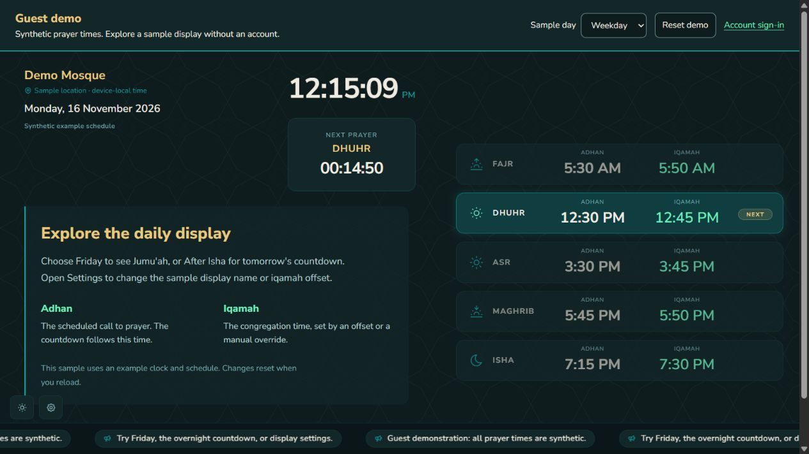

# Nimaaz Time Viewer

A React and TypeScript prayer-time display for a mosque screen, with configurable adhan/iqamah times, a next-prayer countdown, announcements and account-synced settings.

**[Guest demo](https://nimaaz-time-viewer.vercel.app/?demo=1)** · [Account application](https://nimaaz-time-viewer.vercel.app) · [Code tour](#code-tour) · [Run locally](#run-locally)

The guest demo uses synthetic prayer times and an example clock. It needs no account, Firebase configuration or prayer-provider connection. Switch between weekday, Friday and overnight scenarios; try the theme toggle or change the sample display name and iqamah offset. Changes remain in memory and reset on reload. The account application still requires sign-in.

The demo link requires deployment of this branch; the existing production deployment will not gain demo mode until the change is merged and deployed.



## Try the guest demo locally

With Node 24, run `npm ci` and `npm run dev`, then open the URL printed by Vite with `?demo=1` appended. No `.env` file is needed for the demo. Account mode needs the Firebase setup below.

## Features in the implementation

- Location search and Aladhan prayer-time calculation methods.
- Configurable iqamah offsets, manual time overrides and a separate Friday Jumu'ah entry.
- Countdown to the next congregational prayer, including tomorrow's schedule.
- Mosque name, announcements, Hijri date/holiday information and optional rotating hadith content.
- Light/dark display themes and automatic switching around Fajr and Maghrib.
- Firebase email/password authentication and per-user Firestore settings.
- Browser-local settings, Firestore IndexedDB persistence and cached monthly prayer calendars.
- PWA manifest and service-worker caching of the application shell.

The display and demo share prayer-list, Friday-selection and countdown calculations. Account-backed features require a configured development project.

## Stack

| Layer | Technology |
|---|---|
| UI | React 18, TypeScript, Tailwind CSS, Tabler icons |
| Build | Vite, vite-plugin-pwa |
| Accounts and persistence | Firebase Authentication, Cloud Firestore |
| Dates and schedules | date-fns, Aladhan API |
| Location search | OpenStreetMap Nominatim |
| Optional hadith | hadithapi.com through a Vite/Vercel proxy |

## Run locally

The production build was verified with Node 24 on 14 November 2026. Use npm with the committed lockfile.

```bash
git clone https://github.com/zumarzehgeer/nimaazTimeViewer.git
cd nimaazTimeViewer
npm ci
```

Copy `.env.example` to `.env.local` and fill in the web-app configuration from a **separate development Firebase project**. In PowerShell:

```powershell
Copy-Item .env.example .env.local
```

In Bash, use `cp .env.example .env.local`. Then:

```bash
npm run dev
```

Open the URL printed by Vite. On Windows, use `npm.cmd` if PowerShell execution policy blocks npm's script.

### Firebase prerequisites

1. Register a web app in your development Firebase project and populate all six `VITE_FIREBASE_*` values from its configuration.
2. Enable email/password sign-in in Firebase Authentication and authorize the development hostname if required.
3. Create a Cloud Firestore database. Configure rules so authenticated users can access only documents belonging to their own UID, covering the paths below. This repository currently does not include deployable Firestore rules or rule tests; review that configuration before using real data.
4. Start the app and use a disposable development account and synthetic mosque details. Choose a location and verify the display/settings in that isolated project.

Firebase web-app configuration is embedded in the browser bundle; it is not a service-account credential or a substitute for Firestore rules. Never put Firebase Admin credentials or private service-account keys in `VITE_*` variables.

### Configuration

| Variable | Firebase web-app field |
|---|---|
| `VITE_FIREBASE_API_KEY` | `apiKey` |
| `VITE_FIREBASE_AUTH_DOMAIN` | `authDomain` |
| `VITE_FIREBASE_PROJECT_ID` | `projectId` |
| `VITE_FIREBASE_STORAGE_BUCKET` | `storageBucket` |
| `VITE_FIREBASE_MESSAGING_SENDER_ID` | `messagingSenderId` |
| `VITE_FIREBASE_APP_ID` | `appId` |

Missing `VITE_FIREBASE_API_KEY` causes the application to stop at runtime with a configuration message. A successful build alone does not validate Firebase configuration, sign-in or database access.

Hadith content is optional and configured in application settings. Its current API key is supplied by the browser to `/api/hadith`; do not use a privileged credential. The Vite development proxy handles that endpoint locally. In production, `api/hadith.js` supplies the Vercel function; a static host must provide an equivalent endpoint for that feature.

## Code tour

| Entry point | Responsibility |
|---|---|
| `src/App.tsx` | Auth/setup/display states, schedule composition and theme coordination |
| `src/demo/DemoApp.tsx` | Isolated synthetic demonstration and in-memory display controls |
| `src/lib/prayers.ts`, `src/lib/countdown.ts` | Shared schedule rules and next-adhan calculation |
| `src/components/MosqueDisplay.tsx` | Main display composition |
| `src/components/SettingsModal.tsx` | Display and schedule configuration |
| `src/components/AuthScreen.tsx` | Email/password account flows |
| `src/hooks/useCountdown.ts` | Next-prayer selection and countdown |
| `src/hooks/useSettings.ts` | Local settings and debounced cloud saves |
| `src/hooks/useFirestoreSettings.ts` | Firestore subscription and default merging |
| `src/hooks/usePrayerCache.ts` | Monthly calendar caching and refresh/fallback behavior |
| `src/services/aladhan.ts` | Prayer calendars, methods and Hijri-related requests |
| `src/services/geocoding.ts` | Nominatim search/reverse lookup |
| `src/services/hadith.ts` | Hadith selection and proxy requests |
| `src/firebase.ts` | Firebase initialization and persistent multi-tab cache |
| `vite.config.ts`, `api/hadith.js` | PWA caching and development/production proxy |

### Data flow and storage

After sign-in, the user's settings are read from Firestore and overlaid on defaults. Local changes update the screen/localStorage immediately, with Firestore writes debounced by 500 ms. The prayer cache reads stored monthly calendars and requests missing or stale calendar data; uncached daily values can fall back to the prayer-time API.

Firestore paths used by the source:

```text
users/{uid}/profile/info
users/{uid}/config/mosque
users/{uid}/prayerCache/{YYYY-MM}
```

The browser also stores settings, theme and failed-month bookkeeping. Offline operation depends on previously populated caches and an existing session; a first visit without connectivity cannot be assumed to work.

## Build and checks

```bash
npm run build
npm test
npx playwright install chromium
npm run test:e2e
npm run preview
```

The build performs TypeScript checking and creates `dist/`. Preview serves the static build; it does not run the Vercel API function. Node's test runner covers schedule boundaries and overrides. Playwright checks the built guest demo on desktop and mobile Chromium, including provider/account isolation, settings, reset, theme and keyboard focus. CI runs installation, unit tests, build and browser tests. It does not validate real account access, Firestore rules or live providers. See the dated [validation and dependency record](docs/VALIDATION.md).

## Current limitations

- Guest mode uses synthetic data and omits cloud synchronization and live optional content; account mode remains gated by authentication.
- Firestore access rules and their tests are not versioned here.
- Clock/countdown logic uses browser-local dates. Verify the display device's timezone matches the intended mosque schedule; selecting a remote location alone does not establish timezone correctness.
- Offline fallback can reuse stale calendar data, including previous-year data when available. Treat this as approximate fallback behavior and confirm schedules against local mosque guidance.
- Public APIs, fonts and optional content depend on network access and provider availability. Cached assets do not guarantee complete offline operation.
- Automated coverage for real account settings synchronization and Firestore authorization remains follow-up work.
- Dependency patches removed the two critical audit findings and reduced the total from 24 to 10. Firebase's transitive gRPC and PWA build dependencies still have findings; see the validation record. This is not a claim of zero known vulnerabilities.

## Attribution

Prayer times and calendar metadata come from Aladhan; location lookup uses OpenStreetMap Nominatim; optional hadith content comes from hadithapi.com. Third-party packages retain their respective licenses. This repository does not currently declare a project license.
